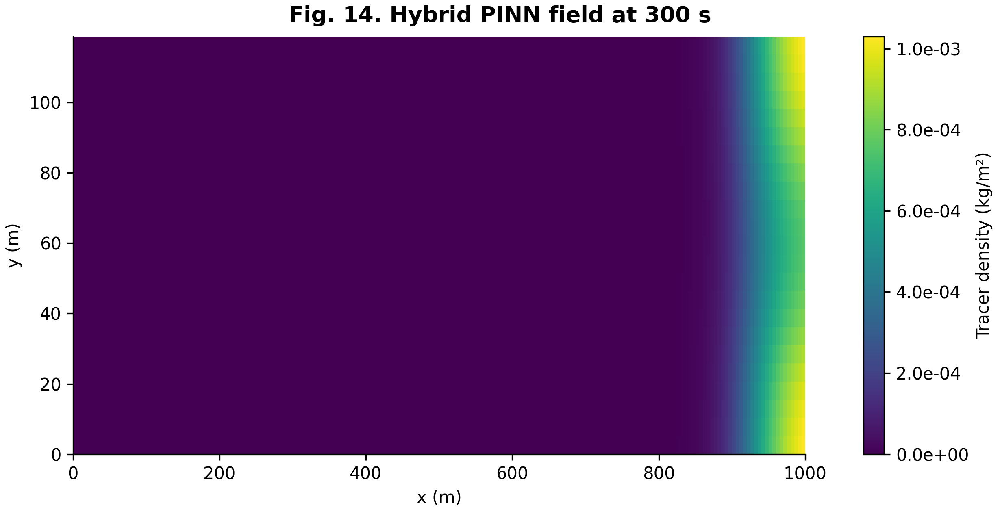
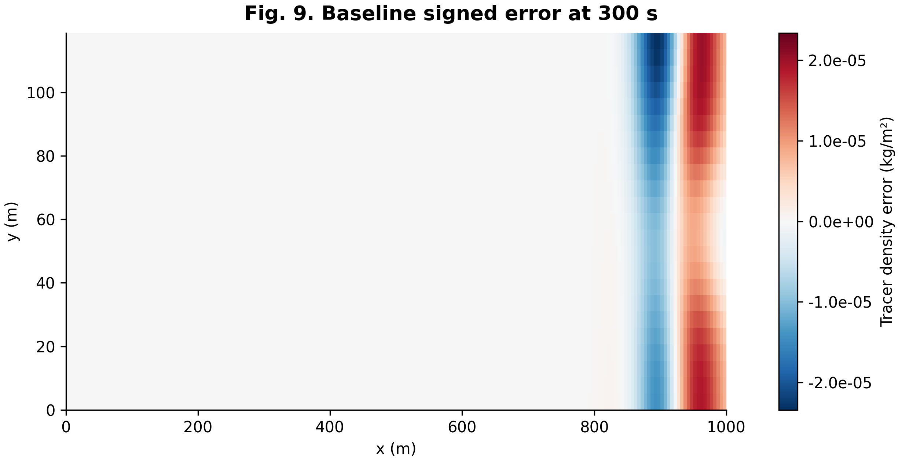
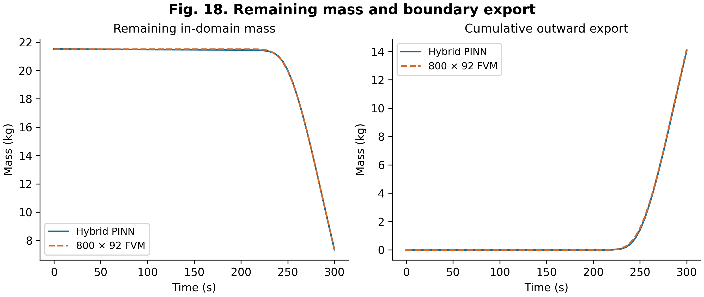
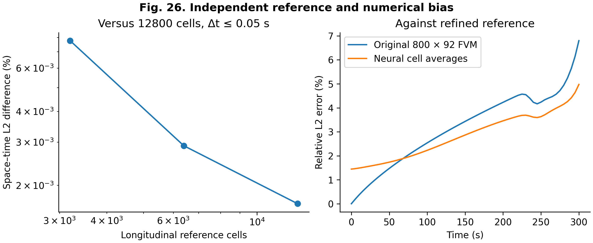
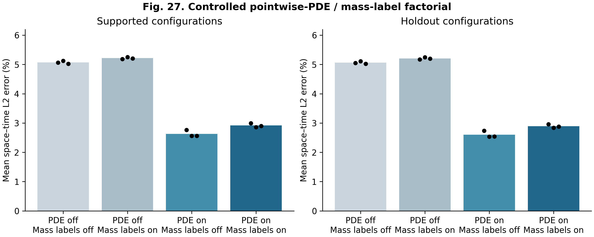
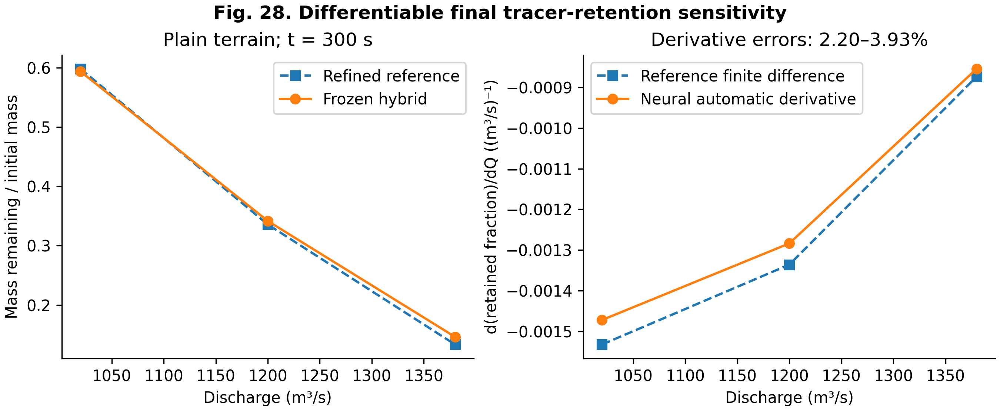

# Discretization-aware verification of a hybrid tracer surrogate

**Authors:** [Vaishnavi Soni](https://github.com/Vaishnavi-Soni-12) and [Zian Rajeshkumar Surani](https://github.com/Zian-Surani). See [attribution and Git identity notes](CONTRIBUTORS.md).

## Actual project outputs

These figures are generated from released model checkpoints and numerical records, not illustrative AI-generated results. Captions distinguish simulation outputs from measurements. [Figure provenance](outputs/paper_figures/figure_manifest.json) records the source of each plot; [dataset provenance](docs/DATA_PROVENANCE.md) explains the real-world data connection.

### Predicted tracer field at 300 seconds


### Signed error against the original upwind reference


### Flux-inclusive mass balance


### Independently refined-reference comparison


### Controlled loss comparison and discharge sensitivity



## Real-world data lineage

The raw GRWL audit reproduces all four configured widths from 42,077 summary records. Widths are midpoints of global, dataset-informed ranges; terrain assignment is a modelling choice. CHIRPS and HydroSHEDS files are available locally but do not provide the active discharge factors or measured tracer labels. No ERA5 ingestion is implemented. Consequently, this is an idealized verification study with GRWL-informed widths, not a four-dataset-coupled field forecast. Exact derivations, raw-file hashes, official source links and limitations are in [DATA_PROVENANCE.md](docs/DATA_PROVENANCE.md).

## Final audit

The 24 November 2026 audit reran all 72 supported evaluations: every declared check passed, and the checked numerical metrics and baseline arrays matched the archived results exactly. Both app actions passed. See [audit findings](outputs/final_audit_v031/AUDIT_REPORT.md) and [comparison records](outputs/final_audit_v031/reproduction_comparison.json). Fresh timings are preserved separately and do not replace the manuscript's original ten-repeat benchmark.

Recreate the first 25 figures with `python docs/manuscript_page_audit/build_figure_package.py --output outputs/paper_figures`; recreate Figures 26–28 with `python -m scripts.plot_reviewer_results`. Schematic figures are identified separately from experimental outputs in the figure manifest.

Version 0.3.1 provides reproducible synthetic experiments for a positive, parameter-conditioned neural approximation to a two-dimensional advection-diffusion equation. Numerical labels and physics penalties train the model. This is a verification study, not a calibrated river-plastic forecast or a new conservation theorem.

## Main findings

- An independent centered-flux/Crank-Nicolson reference changes baseline space-time error from 1.2318% against the original upwind reference to **2.8591%** using neural cell averages. Final-time error is **4.9738%**.
- A matched-seed 2 x 2 experiment separates pointwise PDE penalties from numerical mass labels. Without mass labels, the PDE penalty reduces mean refined-reference error from **5.0709% to 2.6277%** over supported configurations.
- Numerical mass labels improve agreement with the upwind reference but worsen agreement with the independently refined reference. The original full-hybrid checkpoint remains the default; no post-hoc winner is substituted.
- Frozen-model derivatives of retained mass with respect to discharge have **2.20-3.93%** relative error at three audited settings. The app exposes this bounded sensitivity calculation.
- Neural rollout is **6.33 times slower** than the output-grid solver in the recorded CPU workload. Neural conservation is approximate. There are no field observations or validated neural extrapolation beyond 300 seconds.

See [methods](SCIENTIFIC_METHOD.md), [interpretation](docs/REVIEWER_STRENGTHENING.md), and [executed results](outputs/reviewer_strengthening/RESULTS.md). The 240 factorial rows are 20 configurations x four loss combinations x three seeds, not 240 independent training replicates.

## Install and run

Tested: Windows, Python 3.11, AMD Ryzen 9 8940HX CPU, two PyTorch threads, no GPU. requirements-lock.txt pins the tested environment; bitwise reproducibility across processors/builds is not promised. Activate a Python 3.11 virtual environment, then run:

```powershell
python -m pip install -r requirements-lock.txt
python -m pip check
python -B -m unittest discover -s tests -v
python -m streamlit run app.py
```

The release includes checkpoints, metadata and synthetic results. Twenty-five scientific tests cover numerical conservation, analytical convergence, positivity/boundaries, inference guards and derivatives.

## Re-evaluate supplied checkpoints

```powershell
python -B -m scripts.reproduce --workers 1 --output outputs/new_baseline
python -B -m scripts.extended_verification --output outputs/new_extended
python -B -m scripts.reviewer_reference_audit
python -B -m scripts.reviewer_evaluate
python -B -m scripts.plot_reviewer_results
```

The first two commands require a new output directory. Reviewer scripts write under outputs/reviewer_strengthening; preserve released results before rerunning. Missing reference caches are recomputed. reproduce resumes compatible checkpoints, so evaluating the release does not retrain supplied models.

## Retrain the study

Use a separate clone and move its supplied outputs/checkpoints/v5 and outputs/reviewer_strengthening/ablation directories to a backup location, then run:

```powershell
python -B -m scripts.reproduce --workers 1 --output outputs/retrained_baseline
python -B -m scripts.reviewer_ablation --seed 2026
python -B -m scripts.reviewer_ablation --seed 2027
python -B -m scripts.reviewer_ablation --seed 2028
python -B -m scripts.reviewer_evaluate
```

Training uses 6,000 Adam iterations and at most 300 L-BFGS iterations. The factorial reuses matched full-hybrid Adam checkpoints where valid: numerical mass labels enter only in refinement. All four cells retain initial-condition, boundary and physical integral-mass penalties; PDE weight zero does not mean physics-free. The earlier data-only comparator is separate.

## Physical scope and release contents

config.py defines the immutable 1000 m domain, terrain-dependent width, 300 s horizon, 200 x 23 output cells and 61 times. Training labels use 400 x 48 cells; original comparisons use 800 x 92 upwind cells. The extension uses a separately implemented centered-flux reference with exact transverse cosine evolution, 6,400/12,800 longitudinal cells and timestep refinement. Different grids are deliberate convergence controls.

simulation/separable_reference.py exploits constant coefficients and the prescribed separable pulse. It is not an exact solution or a general river solver. Neural centre samples and reference cell averages are distinguished; the baseline also checks Gauss-averaged neural predictions.

Released software, synthetic outputs and checkpoints have an MIT licence. Historical geospatial data, manuscripts, environments and legacy weights are excluded. Historical run hashes identify the execution-time source tree; RELEASE_MANIFEST_SHA256.json identifies this curated release.

## Citation and archival status

Repository: https://github.com/Zian-Surani/PINN-Based-Plastic-Debris-Simulation

Release: https://github.com/Zian-Surani/PINN-Based-Plastic-Debris-Simulation/releases/tag/v0.3.1

Use CITATION.cff for authors and version. **Zenodo DOI pending**; no archival DOI is claimed. The contribution is the controlled verification and sensitivity study. Novelty and journal acceptance require assessment against the literature; the architecture is not claimed to be unprecedented.
